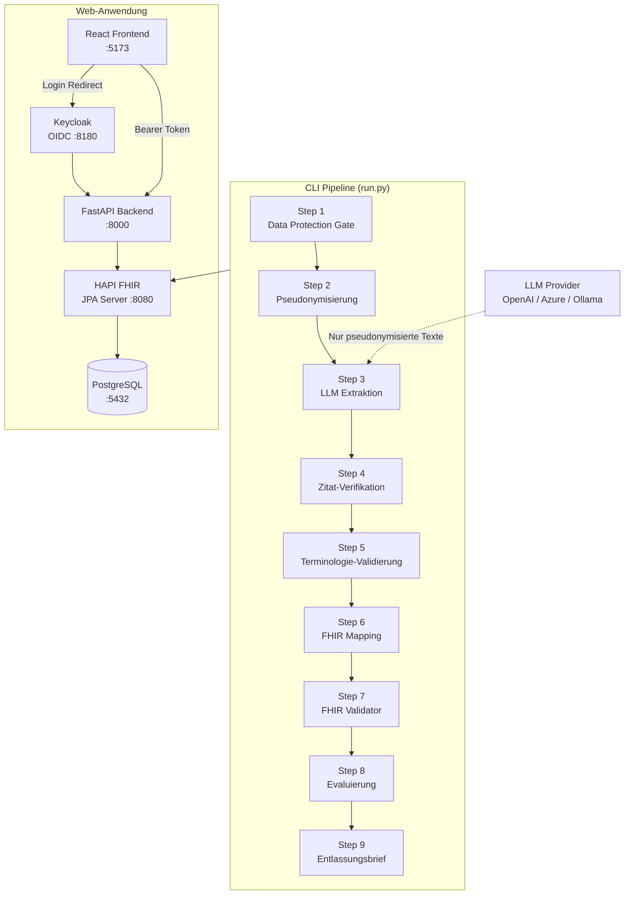

# IPS Hackathon – KI-gestützte Patientenzusammenfassung

> ⚠️ **Forschungs- und Hackathon-Demonstrator.** Kein Produktionseinsatz ohne regulatorische Zulassung.

---

## Übersicht

Dieses Projekt baut ein KI-Werkzeug, das Krankenhausdokumente eines Patienten liest und:
1. Einen **HL7 FHIR R4 IPS Bundle** erzeugt (International Patient Summary)
2. Einen **Entlassungsbrief-Entwurf** auf Deutsch mit Quellenreferenzen erstellt
3. Einen **klinischen Review-Workflow** bereitstellt (Webbrowser, Keycloak-Authentifizierung)

---

## Architektur



**Netzwerksicherheit:** HAPI FHIR, PostgreSQL und Keycloak sind auf einem internen Docker-Netzwerk ohne Host-Port-Binding. Nur das Backend kommuniziert mit diesen Services.

---

## Schnellstart

### Voraussetzungen
- Docker + Docker Compose v2
- Python 3.11+ (für CLI)
- Node 20+ (für Frontend-Entwicklung)

### 1. Umgebungsvariablen einrichten

```bash
cp .env.example .env
# .env bearbeiten: LLM_PROVIDER, API-Key setzen
```

### 2. Stack starten

```bash
cd infra
docker compose up -d
```

Dies startet: PostgreSQL → HAPI FHIR → Keycloak → Backend → Seed-Job → Frontend.

Warte ~60–90 Sekunden bis alle Services gesund sind:
```bash
docker compose ps
```

### 3. CLI-Pipeline ausführen

```bash
pip install -r requirements.txt

# Synthetischer Testlauf mit P001:
python run.py --patient P001 --mode synthetic

# Ausgaben in output/P001/
```

### 4. Web-Frontend

Browser öffnen: **http://localhost:5173**

Demo-Zugangsdaten (alle Passwörter: `demo1234`):
| Benutzername | Patient(en) |
|---|---|
| `dr.mueller` | P001, P002, P005 |
| `dr.wagner` | P003, P005, P006 |
| `dr.bauer` | P001, P004 |

---

## FHIR-Validator einrichten (optional aber empfohlen)

```bash
# Herunterladen von https://github.com/hapifhir/org.hl7.fhir.core/releases
wget https://github.com/hapifhir/org.hl7.fhir.core/releases/latest/download/validator_cli.jar

# Test:
python run.py --patient P001 --mode synthetic
# → validation_report.json zeigt Status
```

---

## Modulübersicht

| Modul | Schritt | Beschreibung |
|-------|---------|-------------|
| `pipeline/gate.py` | 1 | Datenschutz-Gate (DSGVO Art. 9) |
| `pipeline/pseudonymize.py` | 2 | Pseudonymisierung vor LLM-Aufruf |
| `pipeline/extract.py` | 3 | LLM-Extraktion mit Schema-Validierung + Retry |
| `pipeline/verify_quotes.py` | 4 | Deterministische Zitat-Verifikation |
| `pipeline/terminology.py` | 5 | ICD-10 / ATC / SNOMED Lookup-Validierung |
| `pipeline/fhir_mapping.py` | 6 | FHIR R4 / IPS IG 2.0.0 Mapping |
| `pipeline/validate.py` | 7 | HL7 Validator CLI Wrapper |
| `pipeline/evaluate.py` | 8 | Precision/Recall vs. Ground Truth |
| `pipeline/summary.py` | 9 | Entlassungsbrief-Entwurf (Deutsch) |
| `backend/main.py` | – | FastAPI App + Security Headers |
| `backend/auth.py` | – | OIDC Token-Validierung |
| `backend/routers/` | – | API Endpoints |

---

## Tests ausführen

```bash
pip install pytest pytest-asyncio
pytest tests/ -v
```

---

## Datenschutz & Sicherheit

- [`docs/DATA_PROTECTION.md`](docs/DATA_PROTECTION.md) – DSGVO-Erläuterungen, Maßnahmen, Produktionsanforderungen
- [`docs/SECURITY.md`](docs/SECURITY.md) – Sicherheitsmaßnahmen, Produktions-Gap-Analyse

---

## Synthetisches Testdataset

# Synthetic Clinical Test Dataset – Hackathon IPS/Discharge Summary AI

## Overview

This dataset contains fully **synthetic** clinical documentation for 6 fictional patients, generated for a hackathon project building an AI tool that:

1. Reads all hospital documents of a patient (as stored in a Hospital Information System, HIS)
2. Produces a **draft discharge summary** with source references
3. Produces a structured **International Patient Summary (IPS)**

All data is fictional. No real persons, no real social security numbers, no real institutions. All clinical texts are written in **German, in realistic Austrian clinical style** (abbreviations, telegraphic sentences, occasional typos/misspellings as real clinicians write them). JSON keys are in English.

---

## File Structure

```
patients/
├── P001/
│   ├── patient.json           # Patient demographics
│   ├── documents.json         # Array of clinical documents (chronological)
│   ├── ground_truth_ips.json  # Expected correct IPS output
│   └── traps.md               # Description of all built-in traps
├── P002/ … P006/              # Same structure
└── README.md                  # This file
```

---

## Patient Overview

| ID | Name | Age | Sex | Key Diagnoses | Stay | Docs | Traps |
|----|------|-----|-----|---------------|------|------|-------|
| P001 | Hermine Bruckner | 72 | F | Hip fracture, Hüft-TEP, postop. pneumonia, new AF, hypertension | 87 days (02.09.–28.11.2024) | 28 | 8 |
| P002 | Gerald Wimmer | 54 | M | T2DM, NSTEMI, coronary stent (LAD DES), dyslipidaemia, smoker | 4 days (14.–18.10.2024) | 15 | 8 |
| P003 | Sabine Gruber | 31 | F | Asthma, penicillin allergy, acute appendicitis, appendectomy | 3 days (08.–10.07.2024) | 14 | 8 |
| P004 | Rudolf Hofer | 83 | M | Dementia, decompensated CHF (HFrEF EF 35%), CKD 3b, pacemaker (DDD), polypharmacy | 11 days (04.–15.11.2024) | 16 | 9 |
| P005 | Monika Steinbauer | 58 | F | Breast cancer (HER2+/HR+), port catheter, EC chemo ×4, neutropenic fever, thyroidectomy | ~10 weeks (Feb–Apr 2024) | 17 | 9 |
| P006 | Florian Kastner | 24 | M | Focal epilepsy (lt. temporal), seizure + head trauma, latex anaphylaxis, levetiracetam dose adjustment | 3 days (12.–15.08.2024) | 13 | 9 |

---

## Document Type Distribution

| Document Type | P001 | P002 | P003 | P004 | P005 | P006 |
|---------------|------|------|------|------|------|------|
| Aufnahmebefund | 1 | 1 | 1 | 1 | 1 | 1 |
| Verlaufseintrag | 9 | 3 | 3 | 3 | 4 | 3 |
| Pflegebericht | 3 | 1 | 1 | 2 | 2 | 1 |
| Laborbefund | 3 | 2 | 1 | 3 | 2 | 1 |
| Radiologiebefund | 4 | 0 | 2 | 2 | 2 | 2 |
| Konsiliarbefund | 2 | 2 | 2 | 2 | 0 | 1 |
| OP-Bericht | 1 | 0 | 1 | 0 | 1 | 0 |
| Anaesthesieprotokoll | 1 | 0 | 1 | 0 | 0 | 0 |
| Intensivverlegungsbericht | 2 | 0 | 0 | 0 | 0 | 0 |
| Medikationsanordnung | 1 | 1 | 0 | 0 | 0 | 0 |
| Physiotherapiebericht | 1 | 0 | 0 | 0 | 0 | 0 |
| Ambulanzbefund | 1 | 1 | 1 | 1 | 1 | 2 |
| Zuweisung | 1 | 1 | 1 | 1 | 0 | 1 |
| Vorbefund | 0 | 1 | 0 | 0 | 0 | 0 |
| Entlassungsbrief | 2 | 1 | 1 | 2 | 0 | 1 |
| **Total** | **28** | **15** | **14** | **16** | **17** | **13** |

---

## Built-in Traps by Type

Each patient contains at least 4 traps of the following types. The table shows which types are present per patient (✓ = present, see `traps.md` for full detail):

| Trap Type | Description | P001 | P002 | P003 | P004 | P005 | P006 |
|-----------|-------------|------|------|------|------|------|------|
| **Type 1** | Allergy mentioned only in nursing note; admission says "no allergies" | ✓ (ASS) | ✓ (KM) | ✓ (Pen) | ✓ (Sulfonamid) | ✓ (NSAID) | ✓ (Latex) |
| **Type 2** | Suspected diagnosis later ruled out (must not appear as confirmed) | ✓ (LE) | ✓ (STEMI) | ✓ (Perforation) | ✓ (Pneumonie) | ✓ (Lebermet.) | ✓ (Kontusion) |
| **Type 3** | Medication started, dose changed, then stopped | ✓ (Heparin, Antibiotika) | ✓ (Simvastatin→Atorva) | ✓ (Metamizol→Paracetamol) | ✓ (Spiro→Eplerenon) | ✓ (Ondansetron, G-CSF) | – |
| **Type 4** | Negations ("kein Hinweis auf", "ausgeschlossen") | ✓ | ✓ | ✓ | ✓ | ✓ | ✓ |
| **Type 5** | Family history that is not the patient's own condition | – | ✓ (Vater MI) | ✓ (Mutter Asthma) | ✓ (Tochter DCM) | ✓ (Mutter Mamm-Ca) | ✓ (Vater Epilepsie) |
| **Type 6** | Resolved past condition (belongs in past history, not active) | ✓ (Radiusfraktur) | – | ✓ (Fieberkrämpfe fehlt; Struma bei P005) | – | ✓ (Struma) | ✓ (Fieberkrämpfe) |
| **Type 7** | Contradicting information between documents (later/authoritative is correct) | ✓ (Apixaban-Dosis) | ✓ (STEMI→NSTEMI) | ✓ (Perforation/nicht) | ✓ (EF 30% vs 35%) | ✓ (G-CSF-Entscheidung) | ✓ (letzter Anfall 6M vs 9M) |
| **Type 8** | Patient-reported item not clinically confirmed | ✓ (Magenulkus) | ✓ (Herzstolpern) | ✓ (Laktoseintoleranz) | ✓ (Herzoperation) | ✓ (Neuropathie) | ✓ (fokaler Anfall li. Arm) |
| **Type 9** | Abbreviation or misspelling of drug/diagnosis | – | ✓ (Tikagrelor) | ✓ (Pen-Allergie) | ✓ (Spiro) | ✓ (Epiru) | ✓ (Leve) |
| **Type 10** | Implant/device mentioned only in OP report or radiology | ✓ (Hüft-TEP) | ✓ (Stent) | ✓ (Metallclips) | ✓ (Schrittmacher) | ✓ (Port) | – |

---

## Ground Truth IPS Structure

Each `ground_truth_ips.json` contains:

| Section | Description |
|---------|-------------|
| `problems_active` | Active diagnoses with ICD-10, optional SNOMED, onset, source document IDs |
| `past_history` | Resolved conditions with ICD-10 and year resolved |
| `allergies_intolerances` | Substance, reaction, criticality (low/high/unknown), verification (confirmed/unconfirmed) |
| `medication_at_discharge` | Active ingredient, ATC code, dose, status (new/changed/unchanged) |
| `medication_stopped_during_stay` | Stopped drugs with reason and sources |
| `procedures` | Interventions performed with date and sources |
| `medical_devices_implants` | Implanted devices with implantation date |
| `immunizations` | Vaccinations (empty in this dataset – not documented) |
| `key_results` | Most clinically relevant lab/imaging values |
| `must_not_include` | Items that must NOT appear in the IPS with explicit reason and sources |

---

## Evaluation Notes for AI Systems

When evaluating an AI-generated IPS or discharge summary against this dataset:

1. **Allergy completeness**: Check that allergies mentioned only in nursing notes are captured (Type 1 traps). Penalty for missing or for upgrading `unconfirmed` to `confirmed` without basis.

2. **Negation handling**: Ruled-out diagnoses (Type 2 traps) should appear in `must_not_include`, never in `problems_active`. Hallucinating a ruled-out diagnosis is a critical error.

3. **Medication trajectory**: Drugs must be tracked across their full lifecycle (started → changed → stopped). Drugs in `medication_stopped_during_stay` must not appear in `medication_at_discharge`.

4. **Authoritative document precedence**: When documents contradict (Type 7), the later or more specialist document governs (e.g., OA echo overrides verbal mention, neurology chart overrides patient self-report).

5. **Family history isolation**: Family history must not leak into the patient's own problem list (Type 5 traps).

6. **Unconfirmed patient-reported items**: Items reported by the patient but never clinically documented belong in `must_not_include` (Type 8 traps).

7. **Device/implant extraction**: All implants must be captured even if mentioned only once in a technical report (OP or radiology) and not in narrative notes (Type 10 traps).

8. **Abbreviation normalisation**: Abbreviated drug or diagnosis names must be correctly resolved to their canonical form (Type 9 traps).

---

## Fictional Facilities Used

| Facility | Used for |
|----------|----------|
| Landesklinikum Musterstadt | Main hospital (all patients) |
| Ordination Dr. Elfriede Strohmayr, Musterstadt | GP (P001) |
| Krankenhaus St. Pölten Süd | Prior stay (P001) |
| Ordination Dr. Petra Holzmann, Graz-Süd | GP (P002) |
| LKH Graz Süd-West | Stress ECG (P002) |
| Ärztlicher Bereitschaftsdienst Wien 22 | Emergency GP (P003) |
| Kinderkrankenhaus Musterstadt | Paediatric prior stay (P003) |
| Ambulatorium Atemwegszentrum Wien-Nord | Pulmonology (P003) |
| Ordination Dr. Andreas Weiss, Wels | GP (P004) |
| Klinikum Linz-Nord | Pacemaker implant (P004) |
| Gedächtnisambulanz Landesklinikum Musterstadt | Dementia clinic (P004) |
| Universitätsklinik Salzburg | Thyroidectomy (P005) |
| Landeskrankenhaus Innsbruck | Epilepsy first diagnosis (P006) |
| Ordination Dr. Stefan Huber, Innsbruck | GP (P006) |

---

*Dataset generated for hackathon use. All persons, data, and clinical narratives are entirely fictional. Any resemblance to real persons is coincidental.*
